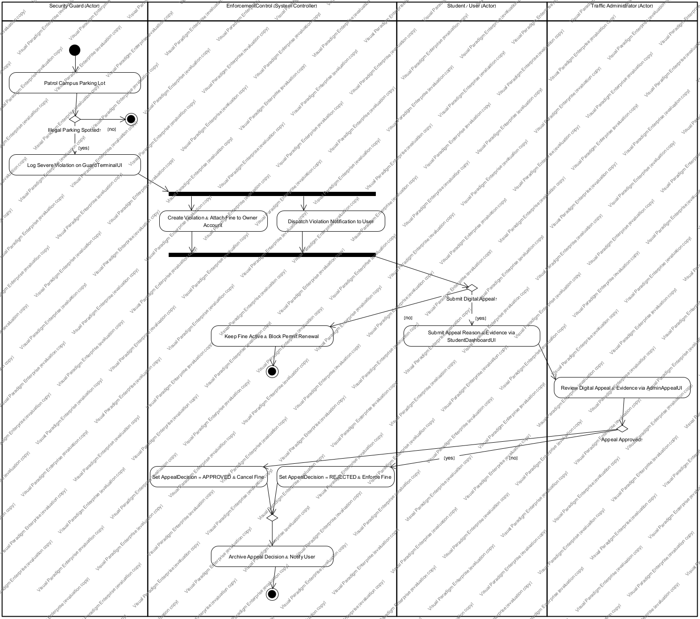
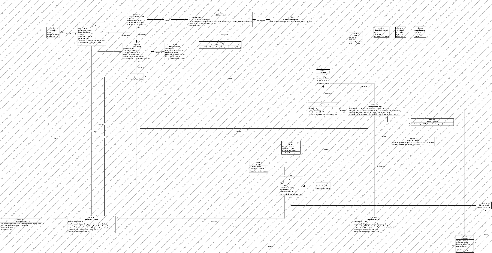
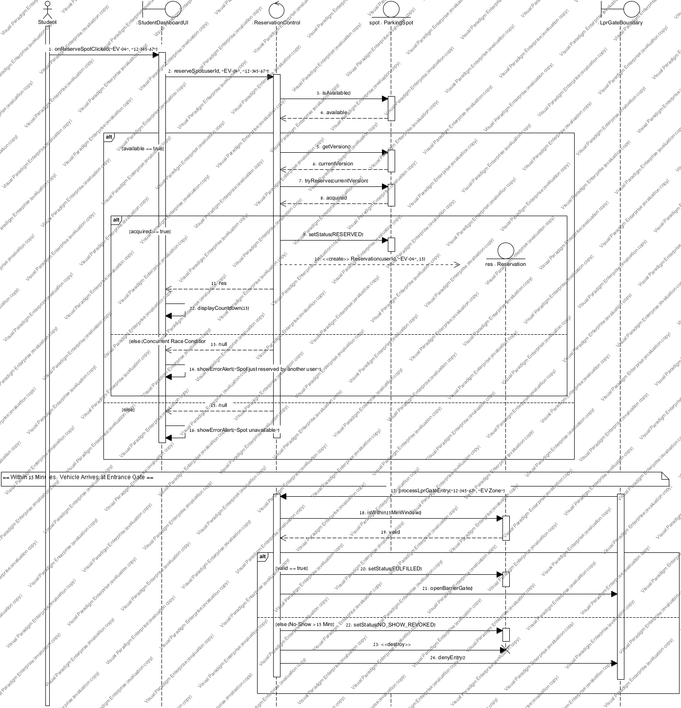
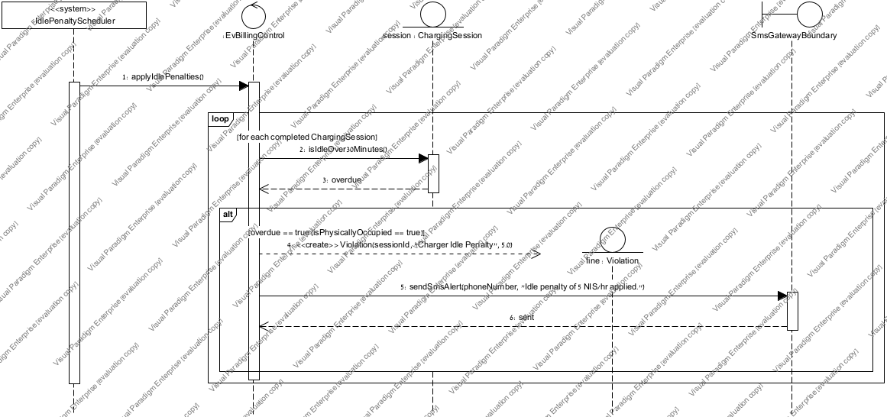

# System Architecture & Object-Oriented Design (`Ex4_SmartParking_Design`)

**Course:** 61756 Software Engineering Methods (Academic Year 2026-2027)
**Institution:** ORT Braude College of Engineering | Department of Software Engineering
**Domain:** Smart Campus Parking, LPR, and EV Network (Continued from Exercise 1)

---

## 1. Engineering Team Details

| Role | Full Name |
| :--- | :--- |
| **Student A (Role A)** | Maor Dalal |
| **Student B (Role B)** | Neta Baron |

* **Group Number:** `G08`
* **GitHub Repository URL:** https://github.com/MaorDalal/Ex4_SmartParking_Design

---

## 2. Step 1: Business Process Modeling — Activity Diagram (`Visual Paradigm`)

* **PlantUML Source:** [`diagrams/activity_appeal.puml`](diagrams/activity_appeal.puml)
* **Visual Paradigm Model:** [`SystemModel_Ex4.vpp`](SystemModel_Ex4.vpp)
* **Partitions / Swimlanes:** Separates external **Actors** (`Security Guard`, `Student / User`, `Traffic Administrator`) from the internal **System Controller** (`EnforcementControl`), using `initial node`, `fork`/`join` (AND), `decision` (XOR) with explicit `[guards]`, `merge` (OR), and `activity final node`.



---

## 3. Step 2: Structural Modeling — ECB Class Diagram (`PlantUML` -> `Visual Paradigm`)

Following the **ECB (Entity-Control-Boundary)** architectural pattern:

| ECB Stereotype | Classes in System | Architectural Responsibility |
| :--- | :--- | :--- |
| **`<<boundary>>`** | `StudentDashboardUI`, `GuardTerminalUI`, `AdminAppealUI`, `LprGateBoundary`, `PaymentGatewayBoundary`, `SmsGatewayBoundary` | Interfaces with external Actors and external hardware/payment/SMS systems. Communicates ONLY with `<<control>>` classes. |
| **`<<control>>`** | `ReservationControl`, `EvBillingControl`, `EnforcementControl` | Multiple specialized controllers orchestrating business rules, timers, concurrency checks, and workflows. |
| **`<<entity>>`** | `User` (`Student`, `Faculty`, `SecurityGuard`, `TrafficAdministrator`), `GuestPass`, `Vehicle`, `ParkingZone`, `ParkingSpot`, `Reservation`, `PaymentAuthorization`, `ChargingSession`, `Violation`, `Appeal` + 4 UML `enum`s | Passive domain data classes storing persistent business state and domain helper methods. |

* **PlantUML Source:** [`diagrams/class_diagram_ecb.puml`](diagrams/class_diagram_ecb.puml)
* **Visual Paradigm Model:** [`SystemModel_Ex4.vpp`](SystemModel_Ex4.vpp)



---

## 4. Step 3: Behavioral Modeling — ECB Sequence Diagrams (`PlantUML` -> `Visual Paradigm`)

### 4.1 Sequence Diagram 1: Spot Reservation, LPR Gate Entry & No-Show Destruction
* **PlantUML Source:** [`diagrams/sequence_reservation_ecb.puml`](diagrams/sequence_reservation_ecb.puml)



### 4.2 Sequence Diagram 2: EV Charging 30-Minute Idle Penalty (`loop` & `<<create>>`)
* **PlantUML Source:** [`diagrams/sequence_idle_penalty_ecb.puml`](diagrams/sequence_idle_penalty_ecb.puml)



---

## 5. Independent AI Prompt & Architectural Design Critique (Part 4)

```text
You are a senior software architect reviewing our UML design for
"Smart Campus Parking, LPR, and EV Network" system.

files that you need:
- SYSTEM_STORY.md (the official domain specification)
- diagrams/class_diagram_ecb.puml (our ECB class diagram)
- diagrams/sequence_reservation_ecb.puml (our reservation + LPR gate sequence diagram)

Audit our design strictly against the two edge cases in Section 3 of SYSTEM_STORY.md:

Edge Case A - Double-Booking Race Condition:
Two students click "Reserve" on the last available spot in the Student Zone
at the exact same millisecond. Check whether the `version` attribute and
`tryReserve(expectedVersion): boolean` on ParkingSpot, together with the nested
`alt acquired == true / else` in the sequence diagram, guarantee that only one
reservation succeeds. Point out any gap, for example whether isAvailable() is
checked separately from tryReserve(), or whether the losing student gets a
clear response.

Edge Case B - Physical vs. Electrical EV State:
An EV driver unplugs the charging cable at minute 29 but leaves the car in the
EV bay. Check whether separating `isPluggedIn` from `isPhysicallyOccupied` on
ChargingSession, together with `isIdleOver30Minutes()`, is enough for
EvBillingControl to still apply the 30-minute Charger Idle Penalty.
Say which attribute the idle check must depend on.

For each edge case answer:
1. Does our current design handle it? (Yes / Partially / No, with the reason)
2. Which exact class, attribute, operation or message is responsible?

Then suggest at least ONE additional concrete improvement to our class or
sequence diagram (a new attribute, operation, or message) that would make the
design more robust, and explain briefly why.

Keep the ECB rules: boundary classes talk only to control classes.
Answer in clear English, short bullet points, no code.
```

**Findings of the AI review:**
* **Edge Case A (double booking):** handled by `version` + `tryReserve(expectedVersion)` on `ParkingSpot` (atomic version check) and the nested `alt [acquired == true] / [else (Concurrent Race Condition)]`, where the losing student gets `showErrorAlert(...)`. Gaps found: the expected version was never read before `tryReserve`, and the spot status was never set to `RESERVED`.
* **Edge Case B (unplug at minute 29):** handled by separating `isPluggedIn` from `isPhysicallyOccupied` on `ChargingSession`; `isIdleOver30Minutes()` depends on `isPhysicallyOccupied` + `completedAt`, never on `isPluggedIn` (guard `[overdue == true (isPhysicallyOccupied == true)]` in Sequence Diagram 2).

**Improvements applied to the models:**
* **Improvement 1 (read the version before reserving):** added `+ getVersion() : int` to `ParkingSpot`; Sequence Diagram 1 now calls `getVersion()` (reply `currentVersion`) and then `tryReserve(currentVersion)`.
* **Improvement 2 (mark the spot as reserved):** inside `[acquired == true]` Sequence Diagram 1 calls `setStatus(RESERVED)` on `spot : ParkingSpot` before `<<create>> Reservation`, so other students no longer see the spot in `findAvailableSpots()`.

---

## 6. License
Distributed under the **ORT Braude College Academic License** (61756 Software Engineering Methods, 2026-2027).
